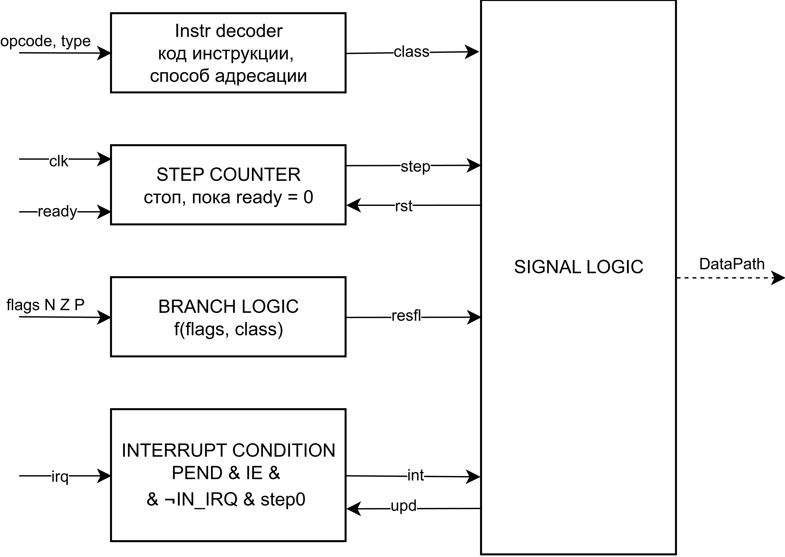

# Лабораторная работа №4. Эксперимент
 
- ФИО: `Рожкова Александра Владимировна`
- Группа: `P3214`
- Вариант: `lisp | acc | harv | hw | trap | port | cstr | cache | alg2`

## Содержание
 
1. [Язык программирования](#язык-программирования)
2. [Организация памяти](#организация-памяти)
3. [Система команд](#система-команд)
4. [Транслятор](#транслятор)
5. [Модель процессора](#модель-процессора)
6. [Кеш](#кеш)
7. [Тестирование](#тестирование)
---

## Язык программирования
### Синтаксис

```
program     ::= toplevel*
toplevel    ::= defun | define | expr

define      ::= "(" "define" name expr ")"
defun       ::= "(" "defun" name "(" name* ")" expr+ ")"

expr        ::= number | string | name | form
form        ::= "(" binop expr expr ")"
              | "(" "if" expr expr expr ")"
              | "(" "progn" expr+ ")"
              | "(" "setq" name expr ")"
              | "(" "loop" "for" name "from" expr "to" expr "do" expr+ ")"
              | "(" name expr* ")"

binop       ::= "+" | "-" | "*" | "/" | "%"
              | "=" | "!=" | "<" | ">" | "<=" | ">="

number      ::= "-"? digit+
string      ::= '"' (<любой символ кроме " и \> | "\n" | "\t" | '\"' | "\\")* '"'
name        ::= letter (letter | digit | "-" | "_")*
```

Зарезервированные слова: `define`, `defun`, `defint`, `if`, `progn`, `let`, `setq`, `loop`, `for`, `from`, `to`, `do`, `not`. Идентификаторы чувствительны к регистру.

Поддерживается только форма `for … from … to … do`.
### Семантика

Любое выражение возвращает значение. 

**Типизация.** Язык поддерживает два типа данных: целые 32-битные числа и строки. Типизация динамическая. Строка это адрес первого символа в памяти данных (C-строка: по слову на символ, в конце слово `0`). Символ это его код.


| Форма                                  | Значение                                                     |
|----------------------------------------|--------------------------------------------------------------|
| `(op a b)`                             | результат бинарной операции над значениями `a` и `b`         |
| `(not a)`                              | 1, если `a = 0`, иначе 0                                     |
| `(if c t e)`                           | значение `t`, если `c != 0`, иначе значение `e`              |
| `(progn e1 ... en)`                    | значение `en` (все выражения вычисляются по порядку)         |
| `(let ((x1 e1) ... (xn en)) b1 ... bm)` | значение `bm`; переменные вычисляются по порядку, видны в теле |
| `(setq x e)`                           | значение `e` (после присваивания переменной `x`)             |
| `(loop for i from a to b do e1 ... en)` | значение `en` на последней итерации; 0, если итераций не было |
| `(f a1 ... an)`                        | значение, возвращённое функцией `f`                          |
| литерал / имя                          | сам литерал / значение переменной                            |

**Стратегия вычислений.** Строгая, аппликативный порядок. Аргументы вычисляются слева направо до вызова функции. Исключения: `if` вычисляет только выбранную ветку; `loop` вычисляет границы один раз до начала цикла.

**Арифметика.** Сложение, вычитание, умножение — по модулю 2³² в знаковом представлении. Деление `/` отбрасывает дробную часть, `%` имеет знак делимого. Деление на ноль — ошибка времени выполнения. Сравнения возвращают 1 (истина) или 0 (ложь).

**Области видимости.** Лексические. Верхнеуровневый `define` создаёт глобальную переменную, видимую во всех функциях. Параметры функции и счётчик `loop` локальны. Внутренние имена затеняют внешние. Функции глобальны и не являются значениями (нельзя передать функцию как аргумент). Обращение к необъявленному имени и повторное определение функции — ошибки трансляции.

**Рекурсия.** Поддерживается: функция может вызывать себя и другие функции, в том числе взаимно. Каждый вызов использует стек; глубина ограничена размером стека.

**Прерывание.** `(defint name () body...)` определяет обработчик, вызываемый аппаратно при приходе символа от устройства ввода. Значение тела игнорируется. Обработчик обменивается данными с основной программой через глобальные переменные.

### Встроенные формы

| Форма            | Действие                                                                           | Значение |
|------------------|------------------------------------------------------------------------------------|---|
| `(port-in n)`    | читает порт `n`                                                                    | прочитанное слово |
| `(port-out n v)` | записывает `v` в порт `n`                                                          | `v` |
| `(getchar s i)`  | читает слово `s[i]`                                                                | символ |
| `(setchar s i c)` | записывает `c` в `s[i]`                                                            | `c` |
| `(makestring n)` | резервирует буфер из `n` слов (при трансляции, размер задаётся числовым литералом) | адрес буфера |
| `(ei)`, `(di)`   | разрешить и запретить прерывания                                                   | 0 |
| `(halt)`         | остановка машины                                                                   | не возвращает |

Процедуры `printchar`, `printstring`, `printnumber`, `readchar` и работа с cstr-строками (`strlen` и другие) реализованы на самом языке в стандартной библиотеке `stdlib.lsp` поверх `port-in`, `port-out`, `getchar` и `setchar`.

### Примеры

Сумма от 1 до 4 

```lisp
(define sum 0)
(loop for i from 1 to 4 do (setq sum (+ sum i)))
(printnumber sum)                       ; 10
```

Цикл как выражение

```lisp
(printnumber (loop for i from 1 to 3 do (* i i)))   ; 9
(setq x (loop for i from 1 to 0 do i))              ; x = 0 (итераций нет)
```

Рекурсия в виде s-выражения:

```lisp
(defun collatz (n steps)
  (if (= n 1)
      steps
      (if (= (% n 2) 0)
          (collatz (/ n 2) (+ steps 1))
          (collatz (+ (* n 3) 1) (+ steps 1)))))

(printnumber (collatz 6 0))             ; 8
```

---

## Организация памяти

- Архитектура гарвардская: память команд и память данных физически разделены, обе однопортовые.
- Машинное слово данных: 32 бита, знаковое. Адресация словами: адрес это номер слова.
- Размеры: память команд 65536 команд (одна команда занимает одну ячейку), память данных 65536 слов.
- Стек расположен в верхней части памяти данных и растёт вниз; его размер 4096 слов. В начале работы `SP` указывает за верхнюю границу памяти данных.
- Порты ввода-вывода образуют отдельное адресное пространство (`in n`, `out n`). Порт 0 это устройство ввода, порт 1 устройство вывода.
- Обращения к памяти данных идут через кеш; память команд не кешируется.

### Регистры

| Ресурс                          | Доступ |
|---------------------------------|---|
| `AC` (аккумулятор)              | единственный регистр, с которым работают команды |
| `SP` (указатель стека)          | косвенно: `push`, `pop`, `call`, `ret`, адресации `[SP+k]` |
| `PS` (счётчик команд)           | косвенно: переходы, `call`, `ret` |
| флаги `Z`, `N`, `P`             | косвенно: условные переходы |
| флаг разрешения прерываний `IE` | `ei`, `di` |
| память данных                   | `ld`, `st`, арифметика с операндом из памяти |
| стек                            | `push`, `pop`, `[SP+k]`, `[[SP+k]]` |
| порты                           | `in`, `out` |

Память команд программно недоступна как данные: код не читается и не изменяется программой.

### Модель памяти

```
       Registers
+------------------------------+
| AC   PS   SP   (DA, DR)      |
| flags: Z N P    IE           |
+------------------------------+

       Instruction memory
+------------------------------+
| 0   : jmp start              |  вектор 0: старт программы
| 1   : jmp int_handler        |  вектор 1: прерывание от ввода
| 2   : library procedures     |  stdlib: printchar, printstring, ...
|    ...                       |
| n   : user procedures        |  defun
|    ...                       |
| i   : interrupt handler      |  defint (пролог, тело, эпилог, iret)
|    ...                       |
| s   : start                  |  код верхнеуровневых форм, затем hlt
+------------------------------+

          Data memory
+------------------------------+
| 0       : string literals    |  cstr, по слову на символ, в конце 0
|    ...  : global variables   |  define, по одному слову
|    ...  : buffers            |  makestring
|    ...                       |
|    ...  : free               |
| 65535-  : stack (grows down) |  параметры, локальные, адреса возврата
+------------------------------+

            Ports
+------------------------------+
| 0 : input device             |
| 1 : output device            |
+------------------------------+
```

Бинарный образ для памяти команд (`code`) и для памяти данных (`data`) хранятся в отдельных файлах. Образ данных содержит строки и нулевые значения глобальных переменных и буферов; он загружается в память данных при старте модели.

### Работа с элементами программы

**1. Литералы.**

- *Числа и символы* всегда кодируются непосредственным операндом команды (`ld 5`, `add 1`). Значение лежит в поле операнда, в памяти данных оно не хранится. Размер поля 32 бита, поэтому подходит любой допустимый литерал.
- *Строки* размещаются в статической памяти данных. В коде используется адрес первого символа (непосредственный операнд, `ld 12`).
- *Порядок размещения.* Строки располагаются от адреса 0 подряд в порядке первого появления в тексте программы. Одинаковые литералы хранятся один раз.
- *Многословный литерал.* Строка занимает `длина + 1` подряд идущих слов: по слову на символ (младшие 8 бит) и завершающий ноль. Числовых литералов, занимающих несколько слов, нет: число двойной точности это два отдельных слова, которыми оперирует программа.

**2. Константы.** Отдельной конструкции для констант нет. `define` с числом создаёт глобальную переменную; если её никто не изменяет, она ведёт себя как константа. Фактически константами служат литералы.

**3. Переменные.**

| Вид                                                 | Где хранится | Адресация |
|-----------------------------------------------------|---|---|
| глобальная (`define`)                               | статическая память данных, по одному слову, после строк в порядке объявления | `[addr]` |
| буфер (`makestring`)                                | статическая память данных, подряд после глобальных, размер известен при трансляции | адрес в операнде, элементы через `getchar` и `setchar` |
| параметр функции                                    | стек | `[SP+k]` |
| переменная `let`, счётчик `loop`, временное значение | стек | `[SP+k]` |

- *Регистры для переменных не используются.* Единственный регистр общего назначения это AC; в нём находится только результат текущего вычисления. Поэтому проблемы нехватки регистров не возникает: все переменные находятся в памяти, а промежуточные значения при необходимости сохраняются на стеке.
- *Куча и динамическая память отсутствуют.* Размеры всех буферов задаются при трансляции. Динамически изменяющиеся данные живут только на стеке.
- *Инициализация.* Глобальные переменные до выполнения `define` равны 0. Присваивание выполняется кодом верхнеуровневой формы: `(define x 5)` транслируется в `ld 5`, `st [addr_x]`.

**4. Инструкции.** Хранятся в памяти команд, по одной команде на ячейку. Код располагается в порядке: вектор, процедуры библиотеки, пользовательские процедуры, обработчик прерывания, код верхнеуровневых форм, `hlt`. При старте `PS = 0`, там `jmp start`.

**5. Процедуры.**

- Тело `defun` хранится в памяти команд, адрес входа это метка, подставляемая транслятором в `call`.
- Соглашение о вызове: аргументы кладутся на стек слева направо (`push`), затем `call` кладёт адрес возврата. Внутри процедуры при пустом временном стеке `[SP+0]` это адрес возврата, `[SP+1]` последний аргумент, `[SP+2]` предпоследний и так далее.
- Результат возвращается в AC. После `ret` вызывающий удаляет аргументы командами `pop`.
- Вызов `(f 1 2)`: `ld 1`, `push`, `ld 2`, `push`, `call f`, `pop`, `pop`.

```
  Стек в начале процедуры f(a b)
  +------------------+
  | [SP+0] return PS |
  | [SP+1] b         |
  | [SP+2] a         |
  | ...    caller    |
  +------------------+
```

**6. Прерывания.**

- *Компиляция.* `defint` используется как обычный код с прологом (`push`: сохранить AC) и эпилогом (`ld [SP+0]`, `pop`, `iret`). Адрес обработчика записывается в вектор 1 (`jmp int_handler`).
- *Исполнение.* Устройство ввода по расписанию выставляет запрос, процессор принимает его на границе команд, если прерывания разрешены (`IE`) и обработчик не выполняется. Аппаратно на стек сохраняются `PS` и флаги, выполнение переходит на вектор 1. Во время обработчика новые прерывания не принимаются; запрос от следующего символа запоминается и обслуживается после `iret`. `iret` восстанавливает флаги и `PS`.
- *Данные.* Обработчик читает порт 0 командой `in 0` и кладёт символ в глобальный буфер. Основная программа читает буфер из той же статической памяти.


## Система команд

## Транслятор

## Модель процессора
Интерфейс командной строки:

```
usage: simulator [-h] code_name data_name input_name
                 [--log [LOG]] [--limit [LIMIT]] [--cache-lines [N]]

Accumulator architecture CPU simulator

positional arguments:
  code_name           input file with binary code
  data_name           input file with static memory content
  input_name          input file with input schedule: [(tick, 'char'), ...]

options:
  -h, --help          show this help message and exit
  --log [LOG]         output file for processor journal
  --limit [LIMIT]     maximum number of ticks to simulate (default 1000000)
  --cache-lines [N]   number of cache lines (default 4)

```

Реализовано в модуле: [src/machine.py](src/machine.py).

DataPath и ControlUnit реализованы как одноимённые классы. DataPath принимает сигналы от ControlUnit в виде объекта `Signals`, хранящего описание сигналов. Обработка сигналов выполняется в методе `DataPath.execute`.

### DataPath


Схема DataPath принимает следующие сигналы от ControlUnit:

- `latch_ps` - записать выбранное значение в регистр PS (`ps_sel`):
  - PS + 1
  - операнд инструкции `operand`
  - вектор прерывания (адрес 1)
  - выход кеша `data_out`
- `latch_dr` - записать в регистр команды DR инструкцию из памяти команд по адресу PS
- `latch_sp` - записать выбранное значение в регистр SP (`sp_sel`):
  - SP + 1
  - SP - 1
- `latch_da` - записать выбранное значение в регистр DA (`da_sel`):
  - операнд инструкции `operand`
  - адрес на стеке со смещением SP + `operand`
  - SP
  - выход кеша `data_out`
- `latch_acc` - записать в регистр ACC результат АЛУ. Правый вход АЛУ выбирается сигналом `b_sel`:
  - операнд инструкции `operand`
  - выход кеша `data_out`
  - значение порта ввода
- `alu_op` - код операции АЛУ между аккумулятором и выбранным значением: `PASS_B` (правый вход без изменений), `ADD`, `SUB`, `MUL`, `DIV`, `REM`
- `latch_flags` - сохранить флаги NF, ZF, PF (`flags_sel`):
  - по результату АЛУ
  - из выхода кеша `data_out` (восстановление при `iret`)
- `mem_rd` - прочитать слово из памяти данных по адресу DA через кеш
- `mem_wr` - записать слово в память данных по адресу DA через кеш. Записываемое значение выбирается сигналом `w_sel`:
  - значение аккумулятора ACC
  - значение PS
  - значение флагов
- `io_wr` - записать аккумулятор в порт вывода, номер порта задаёт `operand`
- `set_ie`, `clr_ie` - установить и сбросить флаг разрешения прерываний IE
- `set_in_irq`, `clr_in_irq` - установить и сбросить флаг IN_IRQ (выполняется обработчик прерывания)
- `ack_irq` - сбросить запрос прерывания PEND
- `halt` - остановить процессор

Флаги:

- NF - признак отрицательности результата АЛУ
- ZF - признак того, что результат АЛУ равен нулю
- PF - признак положительности результата АЛУ
- IE - прерывания разрешены
- IN_IRQ - выполняется обработчик прерывания
- PEND - устройство ввода выставило запрос прерывания

Устройства:

- DATA CACHE - кеш данных прямого отображения, write-through. Чтение: попадание 1 такт, промах 10 тактов. Запись всегда 10 тактов
- DATA MEMORY - однопортовая память данных
- INPUT DEVICE (порт 0) - в такты из расписания записывает символ в порт и выставляет PEND
- OUTPUT DEVICE (порт 1) - принимает символы от аккумулятора

### ControlUnit



### Кеш
Кеш данных стоит между DataPath и памятью данных. Через него идут все обращения к памяти данных.


| Параметр                 | Значение |
|--------------------------|---|
| Чтение, попадание (hit)  | 1 такт |
| Чтение, промах (miss)    | 10 тактов, строка заполняется из памяти |
| Запись                   | всегда 10 тактов |
| Политика записи          | сквозная (write-through), без выделения строки при промахе (write-no-allocate) |


### Сигналы

`mem_rd`, `mem_wr` - начать и удерживать чтение или запись по адресу `DA`.

`ready` - обращение завершено; пока `ready = 0`, SC не меняется, тактовые сигналы удерживаются.

`hit` - описание: слово найдено в строке.

`mem_req` - описание: запрос чтения или записи в память.

`fill_sel` — направление: контроллер -> MUX_FILL — описание: источник слова для строки: `mem_data` или `wdata`.

`latch_line` — направление: контроллер -> массив — описание: записать строку (`V = 1`, `TAG`, `DATA`).

`wdata` — направление: MUX_W -> кеш, DATA_MEM — описание: записываемое слово.

`data_out` — направление: кеш -> DataPath — описание: выходной регистр кеша, прочитанное слово.
### Тестирование