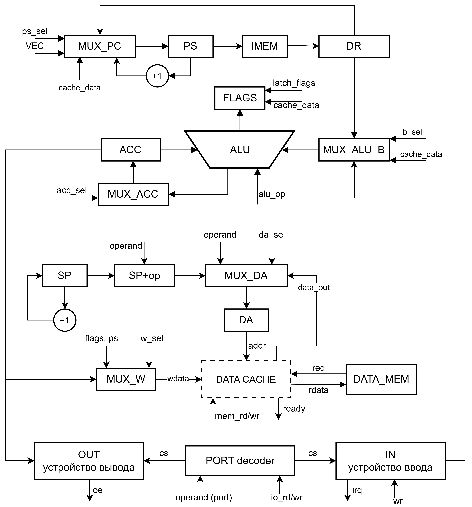
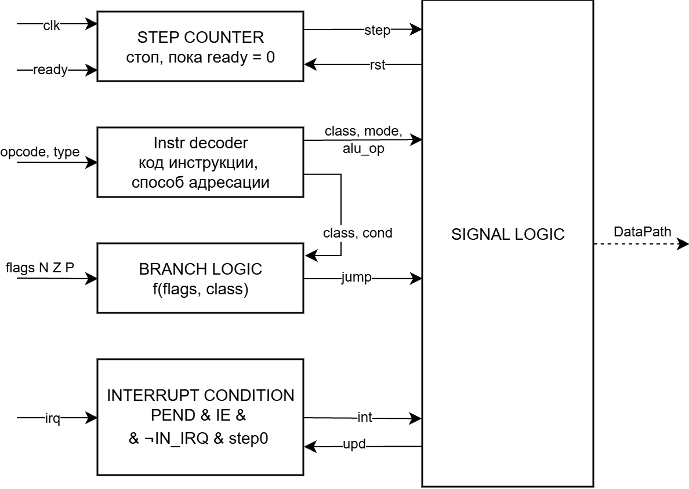

# Лабораторная работа №4. Эксперимент
 
- ФИО: `Рожкова Александра Владимировна`
- Группа: `P3214`
- Вариант: `lisp | acc | harv | hw | trap | port | cstr | cache | alg2`

## Содержание
 
1. [Язык программирования](#язык-программирования)
2. [Организация памяти](#организация-памяти)
3. [Система команд](#система-команд)
4. [Транслятор](#транслятор)
5. [Модель процессора](#модель-процессора)
6. [Кеш](#кеш)
7. [Тестирование](#тестирование)
---

## Язык программирования
### Синтаксис

```
program     ::= toplevel*
toplevel    ::= defun | defint | define | expr

define      ::= "(" "define" name expr ")"
defun       ::= "(" "defun" name "(" name* ")" expr+ ")"
defint      ::= "(" "defint" name "(" ")" expr+ ")"

expr        ::= number | char | string | name | form
form        ::= "(" binop expr expr ")"
              | "(" "not" expr ")"
              | "(" "if" expr expr expr ")"
              | "(" "progn" expr+ ")"
              | "(" "let" "(" binding+ ")" expr+ ")"
              | "(" "setq" name expr ")"
              | "(" "loop" "for" name "from" expr "to" expr "do" expr+ ")"
              | "(" name expr* ")"
binding     ::= "(" name expr ")"
binop       ::= "+" | "-" | "*" | "/" | "%"
              | "=" | "!=" | "<" | ">" | "<=" | ">="

number      ::= "-"? digit+
char        ::= "#\" (<печатный символ> | "newline" | "space" | "tab" | "nul")
string      ::= '"' (<любой символ кроме " и \> | "\n" | "\t" | '\"' | "\\")* '"'
name        ::= letter (letter | digit | "-" | "_")*

comment     ::= ";" <до конца строки>
```

Зарезервированные слова: `define`, `defun`, `defint`, `if`, `progn`, `let`, `setq`, `loop`, `for`, `from`, `to`, `do`, `not`. Идентификаторы чувствительны к регистру.

Поддерживается только форма `for … from … to … do`.
### Семантика

Любое выражение возвращает значение. 

**Типизация.** Язык поддерживает два типа данных: целые 32-битные числа и строки. Типизация динамическая. Строка это адрес первого символа в памяти данных (C-строка: по слову на символ, в конце слово `0`). Символ это его код.


| Форма                                  | Значение                                                                                              |
|----------------------------------------|-------------------------------------------------------------------------------------------------------|
| `(op a b)`                             | результат бинарной операции над значениями `a` и `b`                                                  |
| `(not a)`                              | 1, если `a = 0`, иначе 0                                                                              |
| `(if c t e)`                           | значение `t`, если `c != 0`, иначе значение `e`                                                       |
| `(progn e1 ... en)`                    | значение `en` (все выражения вычисляются по порядку)                                                  |
| `(let ((x1 e1) ... (xn en)) b1 ... bm)` | значение `bm` (переменные вычисляются по порядку, каждая видит предыдущие (как `let*`), видны в теле) |
| `(setq x e)`                           | значение `e` (после присваивания переменной `x`)                                                      |
| `(loop for i from a to b do e1 ... en)` | значение `en` на последней итерации; 0, если итераций не было                                         |
| `(f a1 ... an)`                        | значение, возвращённое функцией `f`                                                                   |
| литерал / имя                          | сам литерал / значение переменной                                                                     |

**Стратегия вычислений.** Строгая, аппликативный порядок. Аргументы вычисляются слева направо до вызова функции. Исключения: `if` вычисляет только выбранную ветку; `loop` вычисляет границы один раз до начала цикла.

**Арифметика.** Сложение, вычитание, умножение — по модулю 2³² в знаковом представлении. Деление `/` отбрасывает дробную часть, `%` имеет знак делимого. Деление на ноль — ошибка времени выполнения. Сравнения возвращают 1 (истина) или 0 (ложь). Сравнение `(< a b)` вычисляется как `a - b` и проверка флагов, поэтому пока разность помещается в 32 бита, корректно.

**Области видимости.** Верхнеуровневый `define` создаёт глобальную переменную, видимую во всех функциях. Параметры функции, переменные `let` и счётчик `loop` локальные. Счётчик `loop` изменять нельзя. Внутренние имена затирают внешние. Функции глобальные, не являются значениями. Обращение к необъявленному имени и повторное определение функции — ошибки трансляции.

**Рекурсия.** Поддерживается: функция может вызывать себя и другие функции, в том числе взаимно. Обычный вызов занимает место на стеке, глубина ограничена размером стека (4096 слов). Хвостовой вызов функцией самой себя транслируется в переход без роста стека: новые аргументы записываются на место параметров, затем `jmp` на начало функции.

**Прерывание.** `(defint name () body...)` определяет обработчик, вызываемый аппаратно при приходе символа от устройства ввода. Значение тела игнорируется. Обработчик обменивается данными с основной программой через глобальные переменные. В программе может быть не больше одного обработчика.

### Встроенные формы

| Форма            | Действие                                                                           | Значение |
|------------------|------------------------------------------------------------------------------------|---|
| `(port-in n)`    | читает порт `n`                                                                    | прочитанное слово |
| `(port-out n v)` | записывает `v` в порт `n`                                                          | `v` |
| `(getchar s i)`  | читает слово `s[i]`                                                                | символ |
| `(setchar s i c)` | записывает `c` в `s[i]`                                                            | `c` |
| `(makestring n)` | резервирует буфер из `n` слов (при трансляции, размер задаётся числовым литералом) | адрес буфера |
| `(ei)`, `(di)`   | разрешить и запретить прерывания                                                   | 0 |
| `(halt)`         | остановка машины                                                                   | не возвращает |

Процедуры `printchar`, `printstring`, `printnumber`, `readchar` и работа с cstr-строками (`strlen` и другие) реализованы на самом языке в стандартной библиотеке `stdlib.lsp` поверх `port-in`, `port-out`, `getchar` и `setchar`.

### Примеры

Сумма от 1 до 4 

```lisp
(define sum 0)
(loop for i from 1 to 4 do (setq sum (+ sum i)))
(printnumber sum)                       ; 10
```

Цикл как выражение

```lisp
(printnumber (loop for i from 1 to 3 do (* i i)))   ; 9
(define x 0)
(setq x (loop for i from 1 to 0 do i))              ; x = 0 (итераций нет)
```

Рекурсия в виде s-выражения:

```lisp
(defun collatz (n steps)
  (if (= n 1)
      steps
      (if (= (% n 2) 0)
          (collatz (/ n 2) (+ steps 1))
          (collatz (+ (* n 3) 1) (+ steps 1)))))

(printnumber (collatz 6 0))             ; 8
```

### Отображение выражений на регистр и память

Регистр общего назначения один — AC. Результат любого выражения после вычисления лежит в AC. Промежуточные значения хранятся на стеке.

- Литерал или переменная: одна команда `ld` (`ld 5`, `ld [addr]`, `ld [SP+k]`).
- `(op L R)`, где `R` — литерал или переменная: вычислить `L` в AC, затем `op R` (`add 1`, `sub [SP+2]`).
- `(op L R)` в общем случае: вычислить `L`, `push`; вычислить `R`, `push`; `ld [SP+1]`; `op [SP+0]`; `pop`; `pop`. Порядок слева направо сохраняется, поэтому некоммутативные операции (`-`, `/`, `%`, сравнения) вычисляются верно.
- Сравнение: `sub` выставляет флаги, затем условный переход выбирает `ld 1` или `ld 0`. Внутри `if` значение 0/1 не строится: сразу переход по флагам на ветку `else`.
- `if` по произвольному условию: вычислить условие, `sub 0` (команда `ld` флаги не меняет), `je else`.
- `(getchar s i)`: вычислить адрес `s + i`, `push`, `ld [[SP+0]]`, `pop`. Для `setchar` аналогично, затем `st [[SP+0]]`.
- `let` и `loop` кладут свои переменные на стек. Транслятор помнит текущую глубину стека и пересчитывает смещения `[SP+k]` для каждой переменной.

---

## Организация памяти

- Архитектура гарвардская: память команд и память данных физически разделены, обе однопортовые.
- Машинное слово данных: 32 бита, знаковое. Адресация словами: адрес это номер слова.
- Размеры: память команд 65536 команд (одна команда занимает одну ячейку), память данных 65536 слов.
- Стек расположен в верхней части памяти данных и растёт вниз; его размер 4096 слов. В начале работы `SP` указывает за верхнюю границу памяти данных.
- Порты ввода-вывода образуют отдельное адресное пространство (`in n`, `out n`). Порт 0 это устройство ввода, порт 1 устройство вывода.
- Обращения к памяти данных идут через кеш; память команд не кешируется.

### Регистры

| Ресурс                          | Доступ |
|---------------------------------|---|
| `AC` (аккумулятор)              | единственный регистр, с которым работают команды |
| `SP` (указатель стека)          | косвенно: `push`, `pop`, `call`, `ret`, адресации `[SP+k]` |
| `PS` (счётчик команд)           | косвенно: переходы, `call`, `ret` |
| флаги `Z`, `N`, `P`             | косвенно: условные переходы |
| флаг разрешения прерываний `IE` | `ei`, `di` |
| память данных                   | `ld`, `st`, арифметика с операндом из памяти |
| стек                            | `push`, `pop`, `[SP+k]`, `[[SP+k]]` |
| порты                           | `in`, `out` |

Память команд программно недоступна как данные: код не читается и не изменяется программой.

### Модель памяти

```
       Registers
+------------------------------+
| AC   PS   SP   (DA, DR)      |
| flags: Z N P    IE           |
+------------------------------+

       Instruction memory
+------------------------------+
| 0   : jmp start              |  вектор 0: старт программы
| 1   : jmp int_handler        |  вектор 1: прерывание от ввода
| 2   : library procedures     |  stdlib: printchar, printstring, ...
|    ...                       |
| n   : user procedures        |  defun
|    ...                       |
| i   : interrupt handler      |  defint (пролог, тело, эпилог, iret)
|    ...                       |
| s   : start                  |  код верхнеуровневых форм, затем hlt
+------------------------------+

          Data memory
+------------------------------+
| 0       : string literals    |  cstr, по слову на символ, в конце 0
|    ...  : global variables   |  define, по одному слову
|    ...  : buffers            |  makestring
|    ...                       |
|    ...  : free               |
| 65535-  : stack (grows down) |  параметры, локальные, адреса возврата
+------------------------------+

            Ports
+------------------------------+
| 0 : input device             |
| 1 : output device            |
+------------------------------+
```

Бинарный образ для памяти команд (`code`) и для памяти данных (`data`) хранятся в отдельных файлах. Образ данных содержит строки и нулевые значения глобальных переменных и буферов; он загружается в память данных при старте модели.

### Работа с элементами программы

**1. Литералы.**

- *Числа и символы* всегда кодируются непосредственным операндом команды (`ld 5`, `add 1`). Значение лежит в поле операнда, в памяти данных оно не хранится. Размер поля 32 бита, поэтому подходит любой допустимый литерал.
- *Строки* размещаются в статической памяти данных. В коде используется адрес первого символа (непосредственный операнд, `ld 12`).
- *Порядок размещения.* Строки располагаются от адреса 0 подряд в порядке первого появления в тексте программы. Одинаковые литералы хранятся один раз.
- *Многословный литерал.* Строка занимает `длина + 1` подряд идущих слов: по слову на символ (младшие 8 бит) и завершающий ноль. Числовых литералов, занимающих несколько слов, нет: число двойной точности это два отдельных слова, которыми оперирует программа.

**2. Константы.** Отдельной конструкции для констант нет. `define` с числом создаёт глобальную переменную; если её никто не изменяет, она ведёт себя как константа. Фактически константами служат литералы.

**3. Переменные.**

| Вид                                                 | Где хранится | Адресация |
|-----------------------------------------------------|---|---|
| глобальная (`define`)                               | статическая память данных, по одному слову, после строк в порядке объявления | `[addr]` |
| буфер (`makestring`)                                | статическая память данных, подряд после глобальных, размер известен при трансляции | адрес в операнде, элементы через `getchar` и `setchar` |
| параметр функции                                    | стек | `[SP+k]` |
| переменная `let`, счётчик `loop`, временное значение | стек | `[SP+k]` |

- *Регистры для переменных не используются.* Единственный регистр общего назначения это AC; в нём находится только результат текущего вычисления. Поэтому проблемы нехватки регистров не возникает: все переменные находятся в памяти, а промежуточные значения при необходимости сохраняются на стеке.
- *Куча и динамическая память отсутствуют.* Размеры всех буферов задаются при трансляции. Динамически изменяющиеся данные живут только на стеке.
- *Инициализация.* Глобальные переменные до выполнения `define` равны 0. Присваивание выполняется кодом верхнеуровневой формы: `(define x 5)` транслируется в `ld 5`, `st [addr_x]`.

**4. Инструкции.** Хранятся в памяти команд, по одной команде на ячейку. Код располагается в порядке: вектор, процедуры библиотеки, пользовательские процедуры, обработчик прерывания, код верхнеуровневых форм, `hlt`. При старте `PS = 0`, там `jmp start`.

**5. Процедуры.**

- Тело `defun` хранится в памяти команд, адрес входа это метка, подставляемая транслятором в `call`.
- Соглашение о вызове: аргументы кладутся на стек слева направо (`push`), затем `call` кладёт адрес возврата. Внутри процедуры при пустом временном стеке `[SP+0]` это адрес возврата, `[SP+1]` последний аргумент, `[SP+2]` предпоследний и так далее.
- Результат возвращается в AC. После `ret` вызывающий удаляет аргументы командами `pop`.
- Вызов `(f 1 2)`: `ld 1`, `push`, `ld 2`, `push`, `call f`, `pop`, `pop`.

```
  Стек в начале процедуры f(a b)
  +------------------+
  | [SP+0] return PS |
  | [SP+1] b         |
  | [SP+2] a         |
  | ...    caller    |
  +------------------+
```

**6. Прерывания.**

- *Компиляция.* `defint` используется как обычный код с прологом (`push`: сохранить AC) и эпилогом (`ld [SP+0]`, `pop`, `iret`). Адрес обработчика записывается в вектор 1 (`jmp int_handler`).
- *Исполнение.* Устройство ввода по расписанию выставляет запрос, процессор принимает его на границе команд, если прерывания разрешены (`IE`) и обработчик не выполняется. Аппаратно на стек сохраняются `PS` и флаги, выполнение переходит на вектор 1. Во время обработчика новые прерывания не принимаются; запрос от следующего символа запоминается и обслуживается после `iret`. `iret` восстанавливает флаги и `PS`.
- *Данные.* Обработчик читает порт 0 командой `in 0` и кладёт символ в глобальный буфер. Основная программа читает буфер из той же статической памяти.


---

## Система команд

### Особенности процессора

- Аккумуляторная архитектура: команды работают с AC и одним операндом.
- Машинное слово данных: 32 бита, знаковое.
- Команды фиксированной длины, один операнд на команду.
- Флаги `Z` (нуль), `N` (отрицательное), `P` (положительное) выставляются командами `add`, `sub`, `mul`, `div`, `rem`. Команда `ld` флаги не меняет.
- Ввод-вывод через порты (`in`, `out`), номер порта задаётся в команде.
- Прерывание по приходу символа от устройства ввода. Пока выполняется обработчик, новое прерывание не принимается: запрос ждёт до `iret`.
- Разрешение прерываний флагом `IE` (команды `ei` и `di`). Признак «выполняется обработчик» хранится во флаге `IN_IRQ`.

### Адресации

| Запись | Тип операнда | Смысл |
|---|---|---|
| `ld 5` | `IMMEDIATE` | операнд лежит в команде |
| `ld [10]` | `ADDRESS` | операнд в ячейке с адресом 10; для переходов это адрес перехода |
| `ld [SP+1]` | `STACK_OFFSET` | операнд в ячейке SP + смещение |
| `ld [[SP+1]]` | `STACK_POINTER` | ячейка SP + смещение хранит адрес операнда |
| `in 0`, `out 1` | `PORT` | номер порта |

### Набор команд

| Мнемоника | Операнд | Описание                                           |
|---|---|----------------------------------------------------|
| `ld` | imm, addr, stack, indirect | AC ← операнд                                       |
| `st` | addr, stack, indirect | память ← AC                                        |
| `add`, `sub`, `mul`, `div`, `rem` | imm, addr, stack, indirect | AC <- AC ∘ операнд, флаги по результату            |
| `jmp` | addr | безусловный переход                                |
| `je` | addr | переход, если ZF = 1                               |
| `jne` | addr | переход, если ZF = 0                               |
| `jg` | addr | переход, если PF = 1                               |
| `jge` | addr | переход, если ZF = 1 или PF = 1                    |
| `jl` | addr | переход, если NF = 1                               |
| `jle` | addr | переход, если ZF = 1 или NF = 1                    |
| `push` | нет | положить AC на стек                                |
| `pop` | нет | снять верхушку стека (SP ← SP + 1), AC не меняется |
| `call` | addr | вызов: адрес возврата на стек, переход             |
| `ret` | нет | возврат: PS <- верхушка стека                      |
| `hlt` | нет | остановка                                          |
| `in` | port | AC ← порт                                          |
| `out` | port | порт ← AC                                          |
| `ei`, `di` | нет | разрешить и запретить прерывания                   |
| `iret` | нет | возврат из прерывания: восстановить флаги и PS     |

Допустимые сочетания команды и типа операнда задаёт таблица `ALLOWED_OPERAND_TYPES` в [src/isa.py](src/isa.py). Недопустимое сочетание — ошибка и в трансляторе, и в модели.

### Такты команд

Цикл команды: выборка из памяти команд (1 такт), формирование адреса операнда (1 такт: `DA <- адрес`, `DA <- SP + смещение`, `DA <- SP` или `DA <- данные`), обращение к памяти данных через кеш, выполнение.

Обозначения: **R** — время чтения данных (1 такт при попадании в кеш, 10 при промахе), **W** — время записи (всегда 10 тактов, кеш сквозной).

| Команда | Формула | Попадание (R=1) | Промах (R=10) |
|---|---|---|---|
| `ld`, `add`, `sub`, `mul`, `div`, `rem`: непосредственный | 1 + 1 | 2 | 2 |
| те же: `[addr]`, `[SP+k]` | 1 + 1 + R + 1 | 4 | 13 |
| те же: `[[SP+k]]` | 1 + (1 + R) + (1 + R) + 1 | 6 | 24 |
| `st [addr]`, `st [SP+k]` | 1 + 1 + W | 12 | 12 |
| `st [[SP+k]]` | 1 + (1 + R) + 1 + W | 14 | 23 |
| `jmp`, `je`, `jne`, `jg`, `jge`, `jl`, `jle` | 1 + 1 | 2 | 2 |
| `push` | 1 + 1 (SP) + 1 (DA) + W | 13 | 13 |
| `pop` | 1 + 1 | 2 | 2 |
| `call` | 1 + 1 (SP) + 1 (DA) + W + 1 (PS) | 14 | 14 |
| `ret` | 1 + 1 (DA) + R + 1 | 4 | 13 |
| `in`, `out`, `ei`, `di`, `hlt` | 1 + 1 | 2 | 2 |
| `iret` | 1 + 2 · (1 + R + 1) | 7 | 25 |
| вход в прерывание (аппаратно) | 2 · (1 + 1 + W) + 1 | 25 | 25 |

Вход в прерывание: дважды `SP ← SP − 1`, `DA ← SP`, запись (сначала PS, затем флаги), после этого `IN_IRQ ← 1`, `PS ← 1` (вектор). Запрос принимается на границе команд, если `PEND = 1`, `IE = 1` и `IN_IRQ = 0`.

### Кодирование команд

Команда занимает 6 байт, little-endian:

| Байты | Поле | Описание |
|---|---|---|
| 0 | opcode | код операции |
| 1 | operand_type | тип операнда |
| 2–5 | operand | знаковое 32-битное число: значение, адрес, смещение или номер порта |

Слово данных занимает 4 байта (`<I`). Кодирование и декодирование: `encode_instruction`, `decode_instruction`, `encode_word`, `decode_word` в [src/isa.py](src/isa.py).

| Код | Команды |
|---|---|
| `0x01`–`0x02` | `ld`, `st` |
| `0x03`–`0x07` | `add`, `sub`, `mul`, `div`, `rem` |
| `0x08`–`0x0E` | `jmp`, `je`, `jg`, `jge`, `jl`, `jle`, `jne` |
| `0x0F`–`0x13` | `push`, `pop`, `call`, `ret`, `hlt` |
| `0x20`–`0x21` | `in`, `out` |
| `0x30`–`0x32` | `ei`, `di`, `iret` |

| Код | Тип операнда |
|---|---|
| 0 | `NONE` |
| 1 | `IMMEDIATE` |
| 2 | `ADDRESS` |
| 3 | `STACK_OFFSET` |
| 4 | `STACK_POINTER` |
| 5 | `PORT` |


---

## Транслятор

Интерфейс командной строки:

```
usage: translator.py [-h] [--listing LISTING] [--ast AST] [--stdlib STDLIB | --no-stdlib]
                     source code data

Транслятор Lisp -> машинный код (acc, harv)

positional arguments:
  source             исходный текст программы
  code               выходной бинарный файл команд
  data               выходной бинарный файл данных

options:
  -h, --help         show this help message and exit
  --listing LISTING  текстовый листинг (по умолчанию <code>.lst)
  --ast AST          записать AST программы в файл
  --stdlib STDLIB    файл стандартной библиотеки
  --no-stdlib        не подключать стандартную библиотеку
```

Реализовано в модуле: [src/translator.py](src/translator.py).

### Листинг

Формат: `<адрес> - <HEX> - <мнемоника> ; <файл>:<строка> <исходный текст>`. Для переходов в угловых скобках указано имя функции. После кода идёт содержимое памяти данных.

```
; code: 33 instructions
    0 - 08021c000000 - JMP 28 <start>           ; interrupt vector 0
    1 - 130000000000 - HLT                      ; interrupt vector 1
; fn_printchar:
    2 - 010301000000 - LD [SP+1]                ; stdlib:2 (port-out 1 c))
    3 - 210501000000 - OUT 1                    ; stdlib:2 (port-out 1 c))
    4 - 120000000000 - RET                      ; stdlib:2 (port-out 1 c))
...
; start:
   28 - 010100000000 - LD 0                     ; user:1 (printstring "Hello, world!")
   29 - 0f0000000000 - PUSH                     ; user:1 (printstring "Hello, world!")
   30 - 110205000000 - CALL 5 <fn_printstring>  ; user:1 (printstring "Hello, world!")
   31 - 100000000000 - POP                      ; user:1 (printstring "Hello, world!")
   32 - 130000000000 - HLT                      ; user:1 (printstring "Hello, world!")
; data: 14 words
    0 - 00000048 - 72 'H'
    1 - 00000065 - 101 'e'
...
```

---


## Модель процессора
Интерфейс командной строки:

```
usage: machine.py [-h] [--log LOG] [--limit LIMIT] [--cache-lines CACHE_LINES] code data input

Модель процессора (acc, harv, trap, port, cache)

positional arguments:
  code                  бинарный файл команд
  data                  бинарный файл данных
  input                 файл с расписанием ввода

options:
  -h, --help            show this help message and exit
  --log LOG             файл журнала работы процессора
  --limit LIMIT         максимум тактов
  --cache-lines CACHE_LINES
                        число строк кеша (0 - без кеша)
```

Реализовано в модуле: [src/machine.py](src/machine.py).

DataPath и ControlUnit реализованы как одноимённые классы. DataPath принимает сигналы от ControlUnit в виде объекта `Signals`, хранящего описание сигналов. Обработка сигналов выполняется в методе `DataPath.execute`.

### DataPath



Схема DataPath принимает следующие сигналы от ControlUnit:

- `latch_ps` - записать выбранное значение в регистр PS (`ps_sel`):
  - PS + 1
  - операнд инструкции `operand`
  - вектор прерывания (адрес 1)
  - выход кеша `data_out`
- `latch_dr` - записать в регистр команды DR инструкцию из памяти команд по адресу PS
- `latch_sp` - записать выбранное значение в регистр SP (`sp_sel`):
  - SP + 1
  - SP - 1
- `latch_da` - записать выбранное значение в регистр DA (`da_sel`):
  - операнд инструкции `operand`
  - адрес на стеке со смещением SP + `operand`
  - SP
  - выход кеша `data_out`
- `latch_acc` - записать в регистр ACC результат АЛУ. Правый вход АЛУ выбирается сигналом `b_sel`:
  - операнд инструкции `operand`
  - выход кеша `data_out`
  - значение порта ввода
- `alu_op` - код операции АЛУ между аккумулятором и выбранным значением: `PASS_B` (правый вход без изменений), `ADD`, `SUB`, `MUL`, `DIV`, `REM`
- `latch_flags` - сохранить флаги NF, ZF, PF (`flags_sel`):
  - по результату АЛУ
  - из выхода кеша `data_out` (восстановление при `iret`)
- `mem_rd` - прочитать слово из памяти данных по адресу DA через кеш
- `mem_wr` - записать слово в память данных по адресу DA через кеш. Записываемое значение выбирается сигналом `w_sel`:
  - значение аккумулятора ACC
  - значение PS
  - значение флагов
- `io_wr` - записать аккумулятор в порт вывода, номер порта задаёт `operand`
- `set_ie`, `clr_ie` - установить и сбросить флаг разрешения прерываний IE
- `set_in_irq`, `clr_in_irq` - установить и сбросить флаг IN_IRQ (выполняется обработчик прерывания)
- `ack_irq` - сбросить запрос прерывания PEND
- `halt` - остановить процессор

Флаги:

- NF - признак отрицательности результата АЛУ
- ZF - признак того, что результат АЛУ равен нулю
- PF - признак положительности результата АЛУ
- IE - прерывания разрешены
- IN_IRQ - выполняется обработчик прерывания
- PEND - устройство ввода выставило запрос прерывания

Устройства:

- DATA CACHE - кеш данных прямого отображения, write-through. Чтение: попадание 1 такт, промах 10 тактов. Запись всегда 10 тактов
- DATA MEMORY - однопортовая память данных
- INPUT DEVICE (порт 0) - в такты из расписания записывает символ в порт и выставляет PEND
- OUTPUT DEVICE (порт 1) - принимает символы от аккумулятора

### ControlUnit



ControlUnit реализован как hardwired-блок и состоит из:

- INSTR DECODER — декодирует инструкцию из DR: код операции, тип операнда, операнд. Проверяет допустимость сочетания операции и типа операнда (`instruction_decoder`)
- STEP COUNTER — номер такта внутри инструкции (0 — выборка инструкции). Увеличивается, пока `ready = 1`, сбрасывается после последнего такта инструкции (`step_counter`)
- BRANCH LOGIC — по флагам вычисляет условие перехода: `je` — ZF, `jne` — not ZF, `jg` — PF, `jge` — ZF or PF, `jl` — NF, `jle` — ZF or NF (`branch_logic`)
- INTERRUPT CONDITION — `PEND and IE and not IN_IRQ and step0`: прерывание принимается только на границе инструкций (`interrupt_condition`)
- SIGNAL LOGIC — по инструкции, типу операнда, номеру такта и условию перехода выдаёт сигналы DataPath (`signal_logic`)

Сигналы по тактам (такт 0 у всех команд — выборка: `latch_dr`, `latch_ps` с `ps_sel = PS + 1`):

| Команда | Такт 1 | Такт 2 | Такт 3 | Такт 4 | Такт 5 | Такт 6 |
|---|---|---|---|---|---|---|
| `ld 5`, `add 5` | `latch_acc` (`b_sel = operand`), `latch_flags` (кроме `ld`) | | | | | |
| `ld [a]`, `ld [SP+k]` | `latch_da` | `mem_rd` | `latch_acc` (`b_sel = data`) | | | |
| `ld [[SP+k]]` | `latch_da` | `mem_rd` | `latch_da` (`da_sel = data`) | `mem_rd` | `latch_acc` | |
| `st [a]`, `st [SP+k]` | `latch_da` | `mem_wr` (`w_sel = ACC`) | | | | |
| `st [[SP+k]]` | `latch_da` | `mem_rd` | `latch_da` (`da_sel = data`) | `mem_wr` | | |
| переход | `latch_ps` (`ps_sel = operand`), если условие выполнено | | | | | |
| `push` | `latch_sp` (SP − 1) | `latch_da` (`da_sel = SP`) | `mem_wr` (`w_sel = ACC`) | | | |
| `pop` | `latch_sp` (SP + 1) | | | | | |
| `call` | `latch_sp` (SP − 1) | `latch_da` (`da_sel = SP`) | `mem_wr` (`w_sel = PS`) | `latch_ps` (`ps_sel = operand`) | | |
| `ret` | `latch_da` (`da_sel = SP`) | `mem_rd` | `latch_ps` (`ps_sel = data`), `latch_sp` (SP + 1) | | | |
| `in` | `latch_acc` (`b_sel = port`) | | | | | |
| `out` | `io_wr` | | | | | |
| `iret` | `latch_da` | `mem_rd` | `latch_flags` (`flags_sel = data`), SP + 1 | `latch_da` | `mem_rd` | `latch_ps` (`ps_sel = data`), SP + 1, `clr_in_irq` |
| вход в прерывание | SP − 1 | `latch_da` | `mem_wr` (`w_sel = PS`) | SP − 1 | `latch_da` | `mem_wr` (`w_sel = FLAGS`); такт 7: `latch_ps` (`ps_sel = vector`), `set_in_irq`, `ack_irq` |

Такт с `mem_rd` или `mem_wr` повторяется, пока кеш не выставит `ready`.

### Принцип работы

* Устройство ввода проверяет расписание: если в этот такт приходит символ, он кладётся в порт 0, выставляется `PEND`
* Проверяется условие прерывания (`PEND and IE and not IN_IRQ and step = 0`), при выполнении начинается вход в прерывание
* По команде в DR и номеру такта (`step`) выбирается набор сигналов `Signals`
* Обработка сигналов в DataPath:
   * Сигнал обращения к памяти (`mem_rd` / `mem_wr`) через кеш, возвращает `ready`
   * Выборка команды из памяти команд в DR
   * Сигналы мультиплексоров PS, SP, DA
   * Сигналы работы с ALU и флагами
   * Запись в порт вывода
   * Защёлкивание регистров
   * Сигналы управления прерываниями (`set_ie`, `clr_ie`, `set_in_irq`, `clr_in_irq`, `ack_irq`, `halt`)
* Если `ready = 1`, счётчик тактов команды (`step`) увеличивается или сбрасывается после последнего такта. Если `ready = 0`, такт повторяется
* Запись состояния процессора в журнал
* Проверка условия остановки: `hlt`, лимит тактов, ошибка


### Журнал

Одна строка на такт: номер такта, режим (`MAIN` — основная программа, `INT` — обработчик прерывания), команда и номер её такта, регистры PS, AC, SP, DA, флаги, IE, PEND и события такта.

```
    200 | MAIN | INTERRUPT ENTRY            s1 | PS=8  AC=0  SP=65531 DA=2     | Z1N0P0 IE1 PEND1 | INPUT 'h' -> порт 0, irq=1; INTERRUPT: вход в обработчик
    202 | MAIN | INTERRUPT ENTRY            s3 | PS=8  AC=0  SP=65531 DA=65531 | Z1N0P0 IE1 PEND1 | CACHE WR [65531] MISS 1/10 wait
    379 | INT  | FETCH -> IRET              s0 | PS=49 AC=0  SP=65530 DA=65529 | Z0N0P1 IE1 PEND0
```

События такта:

- `CACHE RD/WR [адрес] HIT/MISS k/n` — обращение к кешу, `wait` означает, что процессор ждёт память;
- `INPUT 'h'` — символ пришёл в порт ввода;
- `INTERRUPT: вход в обработчик` — начат вход в прерывание;
- `IN port 0 -> 104`, `OUT port 1 <- 'h'` — ввод и вывод.

Полные выдержки журнала с прерываниями есть в golden-тестах (`out_log` в [tests/cat.yml](tests/cat.yml)).


### Кеш
Кеш данных стоит между DataPath и памятью данных. Через него идут все обращения к памяти данных, включая стек (`push`, `call`, `ret`, `iret`, `[SP+k]`). Память команд не кешируется, порты к кешу не относятся.


| Параметр                 | Значение |
|--------------------------|---|
| Организация              | прямое отображение (direct-mapped) |
| Число строк              | 4 (параметр `--cache-lines`, 0 — работа без кеша) |
| Размер строки            | одно слово (32 бита), строка: `V`, `TAG`, `DATA` |
| Разбор адреса            | `INDEX = DA mod 4` (номер строки), `TAG = DA div 4` |
| Чтение, попадание (hit)  | 1 такт |
| Чтение, промах (miss)    | 10 тактов, строка заполняется из памяти |
| Запись                   | всегда 10 тактов |
| Политика записи          | сквозная (write-through), без выделения строки при промахе (write-no-allocate) |


### Сигналы

`mem_rd`, `mem_wr` - начать и удерживать чтение или запись по адресу `DA`.

`ready` - обращение завершено; пока `ready = 0`, SC не меняется, тактовые сигналы удерживаются.

`hit` - описание: слово найдено в строке.

`mem_req` - описание: запрос чтения или записи в память.

`fill_sel` — направление: контроллер -> MUX_FILL — описание: источник слова для строки: `mem_data` или `wdata`.

`latch_line` — направление: контроллер -> массив — описание: записать строку (`V = 1`, `TAG`, `DATA`).

`wdata` — направление: MUX_W -> кеш, DATA_MEM — описание: записываемое слово.

`data_out` — направление: кеш -> DataPath — описание: выходной регистр кеша, прочитанное слово.

В журнале каждый такт обращения отмечается пометкой `CACHE RD [адрес] MISS 3/10 wait`: тип операции, адрес, hit или miss, счётчик тактов. Слово `wait` означает, что процессор ждёт ответа (`ready = 0`).

### Влияние кеша на производительность

Программа `linear_filter` (тесты [linear_filter.yml](tests/linear_filter.yml) и [linear_filter_no_cache.yml](tests/linear_filter_no_cache.yml)) читает 12 чисел и печатает скользящее среднее по окну из трёх соседних. Каждое число читается три раза в соседних окнах, поэтому у обращений есть временная локальность.

Программа, ввод и число выполненных команд (3541) одинаковые, меняется только число строк кеша:

| Строк кеша | Такты | Попадания | Промахи | Ускорение |
|---|---|---|---|---|
| 0 (без кеша) | 32637 | 0 | 1355 | — |
| 1 | 31872 | 85 | 1270 | 2,3 % |
| 2 | 29856 | 309 | 1046 | 8,5 % |
| 4 | 28686 | 439 | 916 | 12,1 % |
| 8 | 25797 | 760 | 595 | 21,0 % |
| 16 | 22233 | 1156 | 199 | 31,9 % |

С 4 строками кеш ускоряет программу всего на 12 %. Причина в прямом отображении: адрес попадает в строку `адрес mod 4`, поэтому стек в конце памяти и массив в начале делят одни и те же 4 строки и постоянно вытесняют друг друга. Чем больше строк, тем реже такие совпадения: с 16 строками ускорение уже 32%.

---

## Тестирование

### Golden-тесты

Один тест — один YAML-файл в папке [tests](tests). Входные данные теста:

- `in_source` — программа на Lisp;
- `in_input` — расписание ввода;
- `config` (необязательно) — настройки модели: `cache_lines`, `limit`.

Результаты, которые проверяет тест:

- `out_ast` — AST программы;
- `out_listing` — машинный код с адресами, HEX и мнемониками, затем содержимое памяти данных;
- `out_stdout` — вывод программы;
- `out_stats` — такты, команды, прерывания, попадания и промахи кеша, причина остановки;
- `out_log` — журнал процессора: первые 40 строк, вход в первое прерывание и возврат из него (если прерывания были), последние 10 строк.

Тест транслирует `in_source`, запускает модель и сравнивает каждое поле `out_*` с эталоном. Запуск — [tests/test_golden.py](tests/test_golden.py).

| Тест | Что проверяет | Ввод | Вывод | Такты | Команды | Прерывания |
|---|---|---|---|---|---|---|
| [hello](tests/hello.yml) | вывод строки | — | `Hello, world!` | 2139 | 314 | 0 |
| [cat](tests/cat.yml) | ввод по прерываниям, вывод | `hello` | `hello` | 2690 | 329 | 5 |
| [hello_user_name](tests/hello_user_name.yml) | ввод строки в буфер, вывод | `Alice` | `What is your name?` / `Hello, Alice!` | 9075 | 1206 | 6 |
| [sort](tests/sort.yml) | разбор чисел, сортировка массива | `5 -3 12 0 7 -10 4` | `-10 -3 0 4 5 7 12` | 26098 | 3235 | 18 |
| [double_precision](tests/double_precision.yml) | 64-битная арифметика: 90-е число Фибоначчи | `90` | `2880067194370816120` | 268548 | 33860 | 3 |
| [collatz_length](tests/collatz_length.yml) | alg2: длина последовательности Коллатца | `27` | `111` | 15202 | 2614 | 3 |
| [infix_to_rpn](tests/infix_to_rpn.yml) | alg2: перевод в обратную польскую запись | `(a+b)*c-d/(e-f)` | `ab+c*def-/-` | 13488 | 1847 | 16 |
| [expressions](tests/expressions.yml) | любая форма — выражение: `if`, `setq`, `loop`, `let`, `progn` | — | `T 2 40 13 15 3 0` | 2982 | 497 | 0 |
| [linear_filter](tests/linear_filter.yml) | кеш, 4 строки | 12 чисел | `6 9 6 5 6 8 10 6 10 9` | 28686 | 3541 | 27 |
| [linear_filter_no_cache](tests/linear_filter_no_cache.yml) | та же программа без кеша | 12 чисел | `6 9 6 5 6 8 10 6 10 9` | 32637 | 3541 | 27 |

### Запуск

```
pip install -r requirements-dev.txt
pytest                                                        # все тесты
pytest -k sort                                                # один тест
UPDATE_GOLDEN=1 pytest                                        # перезаписать эталоны (bash)
$env:UPDATE_GOLDEN=1; pytest; Remove-Item Env:UPDATE_GOLDEN   # то же в PowerShell
```

### CI

[.github/workflows/ci.yml](.github/workflows/ci.yml) на каждый push и pull request:

1. `ruff check .` — линтер, набор правил `ALL`;
2. `ruff format --check .` — форматирование;
3. `mypy` — проверка типов в режиме `strict`;
4. `pytest` — golden-тесты.

Отключённые правила ruff с обоснованием перечислены в [pyproject.toml](pyproject.toml).

### Пример использования

```
$ cat examples/hello.lsp
(printstring "Hello, world!")

$ python src/translator.py examples/hello.lsp hello.code hello.data
команд: 33, слов данных: 14

$ python src/machine.py hello.code hello.data examples/empty.txt --log hello.log
Hello, world!
тактов: 2139, команд: 314, прерываний: 0, кеш: попаданий 95, промахов 39, причина остановки: halt
```

Программа с вводом:

```
$ cat examples/cat.lsp
(loop for i from 1 to 5 do (printchar (readchar)))

$ cat examples/cat.txt
[(200,'h'),(400,'e'),(600,'l'),(800,'l'),(1000,'o')]

$ python src/translator.py examples/cat.lsp cat.code cat.data
$ python src/machine.py cat.code cat.data examples/cat.txt --log cat.log
hello
тактов: 2690, команд: 329, прерываний: 5, кеш: попаданий 58, промахов 78, причина остановки: halt
```